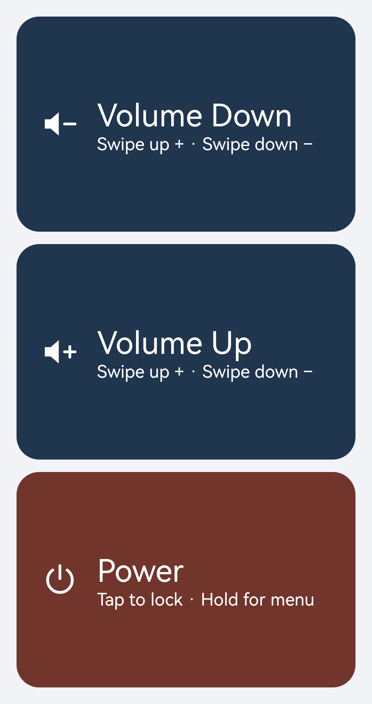

# Android Volume & Power Keys

[简体中文](../../README.md) · [繁體中文](README.zh-Hant.md) · **English** · [日本語](README.ja.md) · [한국어](README.ko.md) · [العربية](README.ar.md) · [ไทย](README.th.md) · [Tiếng Việt](README.vi.md) · [Русский](README.ru.md) · [Español](README.es.md) · [Français](README.fr.md) · [Português (Brasil)](README.pt.md)

This app provides on-screen volume and power controls for older Android phones whose physical buttons have stopped working.

Virtual Keys adds three large on-screen buttons to adjust volume, lock the screen, and open the system power menu. It runs on Android 9 and later and was tested on a Huawei Mate 20 X running Android 10 with EMUI 14.

[Download APK v1.3](https://github.com/sodino/Android-Volume-Power-keys/raw/refs/heads/develop/apk/android-volume-power-keys-v1.3.apk)

## Install and use

1. Download the debug-signed APK, open it on your phone, and follow Android’s installation prompts.
2. Open **Virtual Keys**. Tap **Volume Up** or **Volume Down** to change the volume by one step. Swipe up on either volume button to raise it, or swipe down to lower it. The volume changes step by step as you move.
3. The first time you use **Power**, tap it and choose **Open Settings**. Turn on **Virtual Keys** in Android Accessibility settings, then return to the app. On the tested Huawei phone, the path is **Accessibility → Installed services → Virtual Keys**.
4. Tap **Power** to lock the screen. Touch and hold it to open the system menu, where you can select **Power off** or **Restart**.

Once the phone is completely powered off, the app cannot turn it on. If the physical power button is broken and you want to reboot, choose **Restart** from the system menu.

## Screenshot



## App language

The app supports the 12 languages listed above and follows your system language, with English as the fallback. On Android 13 and later, you can also choose a language for the app in Android Settings.

## Build from source

Use JDK 17 and Android SDK Platform 35. Open the project in Android Studio or set `ANDROID_HOME` to the Android SDK directory. Build the APK with the Gradle wrapper.

```sh
./gradlew :app:assembleDebug
```

The build writes the APK to `app/build/outputs/apk/debug/app-debug.apk`.
