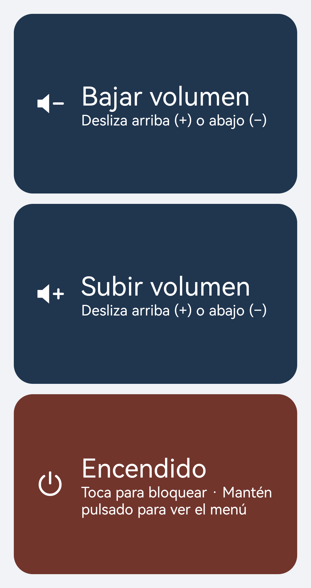

# Botones de volumen y encendido para Android

[简体中文](../../README.md) · [繁體中文](README.zh-Hant.md) · [English](README.en.md) · [日本語](README.ja.md) · [한국어](README.ko.md) · [العربية](README.ar.md) · [ไทย](README.th.md) · [Tiếng Việt](README.vi.md) · [Русский](README.ru.md) · **Español** · [Français](README.fr.md) · [Português (Brasil)](README.pt.md)

**Botones virtuales** añade tres botones grandes en pantalla para ajustar el volumen, bloquear la pantalla y abrir el menú de apagado del sistema. Funciona en Android 9 y versiones posteriores. Se probó en un Huawei Mate 20 X con Android 10 y EMUI 14.

[Descargar APK v1.3](https://github.com/sodino/Android-Volume-Power-keys/raw/refs/heads/develop/apk/android-volume-power-keys-v1.3.apk)

## Instalación y uso

1. Descarga el APK firmado con una clave de depuración. Abre el archivo en tu teléfono y sigue las indicaciones de Android para instalarlo.
2. Abre **Botones virtuales**. Toca **Subir volumen** o **Bajar volumen** para ajustar un nivel. Desliza el dedo hacia arriba en cualquiera de los dos botones de volumen para subirlo, o hacia abajo para bajarlo. El volumen cambia por niveles mientras deslizas el dedo.
3. La primera vez que uses **Encendido**, tócalo y elige **Abrir ajustes**. Activa **Botones virtuales** en los ajustes de accesibilidad de Android y vuelve a la aplicación. En el Huawei de prueba, la ruta es **Accesibilidad → Servicios instalados → Botones virtuales**.
4. Toca **Encendido** para bloquear la pantalla. Mantén pulsado el botón para abrir el menú del sistema, donde puedes apagar o reiniciar el teléfono.

Si el teléfono está completamente apagado, la aplicación no puede encenderlo. Si el botón físico de encendido está averiado y quieres reiniciar el teléfono, elige **Reiniciar** en el menú del sistema.

## Captura de pantalla



## Idioma de la aplicación

La aplicación está disponible en los 12 idiomas indicados arriba. Usa el idioma del sistema y muestra la interfaz en inglés si no encuentra una traducción. En Android 13 y versiones posteriores puedes elegir un idioma para la aplicación en los ajustes del sistema.

## Compilar desde el código fuente

Usa JDK 17 y Android SDK Platform 35. Abre el proyecto en Android Studio o configura `ANDROID_HOME` con la ruta del SDK de Android. Genera el APK con Gradle Wrapper.

```sh
./gradlew :app:assembleDebug
```

El APK se guarda en `app/build/outputs/apk/debug/app-debug.apk`.
