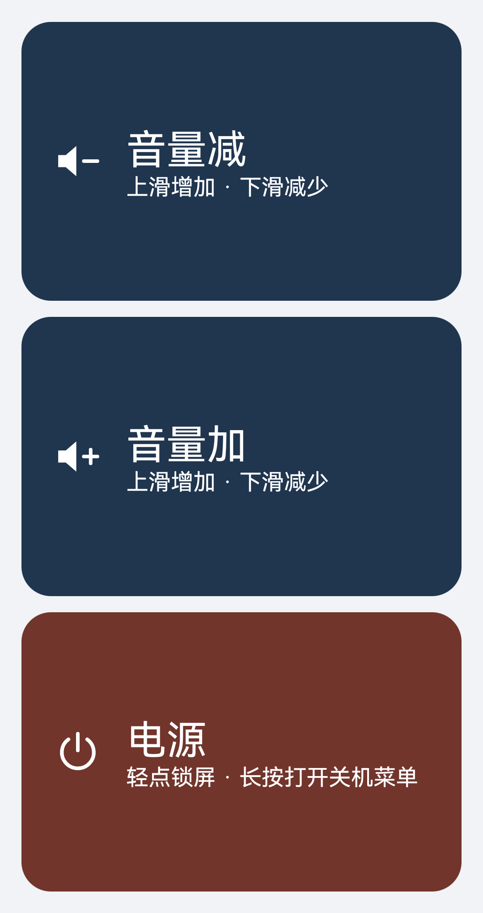

# Boutons de volume et d’alimentation pour Android

[简体中文](../../README.md) · [繁體中文](README.zh-Hant.md) · [English](README.en.md) · [日本語](README.ja.md) · [한국어](README.ko.md) · [العربية](README.ar.md) · [ไทย](README.th.md) · [Tiếng Việt](README.vi.md) · [Русский](README.ru.md) · [Español](README.es.md) · **Français** · [Português (Brasil)](README.pt.md)

**Boutons virtuels** ajoute trois grands boutons à l’écran pour régler le volume, verrouiller l’écran et ouvrir le menu d’alimentation du système. L’application fonctionne à partir d’Android 9 et a été testée sur un Huawei Mate 20 X sous Android 10 avec EMUI 14.

[Télécharger l’APK v1.3](https://github.com/sodino/Android-Volume-Power-keys/raw/refs/heads/develop/apk/android-volume-power-keys-v1.3.apk)

## Installation et utilisation

1. Téléchargez l’APK signé avec une clé de débogage, ouvrez-le sur votre téléphone et suivez les instructions d’installation d’Android.
2. Ouvrez **Boutons virtuels**. Touchez **Volume +** ou **Volume −** pour régler le volume d’un cran. Sur l’un ou l’autre bouton de volume, balayez vers le haut pour augmenter le volume ou vers le bas pour le diminuer. Le volume change par crans pendant le geste.
3. Lors de la première utilisation de **Marche/arrêt**, touchez le bouton et choisissez **Ouvrir les paramètres**. Activez **Boutons virtuels** dans les paramètres d’accessibilité d’Android, puis revenez à l’application. Sur le Huawei testé, le chemin est **Accessibilité → Services installés → Boutons virtuels**.
4. Touchez **Marche/arrêt** pour verrouiller l’écran. Maintenez le bouton enfoncé pour ouvrir le menu du système et choisir d’éteindre ou de redémarrer le téléphone.

Lorsque le téléphone est complètement éteint, l’application ne peut pas le rallumer. Si le bouton d’alimentation physique est en panne et que vous souhaitez redémarrer, choisissez **Redémarrer** dans le menu du système.

## Capture d’écran



## Langue de l’application

L’application est disponible dans les 12 langues indiquées ci-dessus. Elle utilise la langue du système et s’affiche en anglais si aucune traduction ne correspond. Dès Android 13, vous pouvez choisir la langue de l’application dans les paramètres du système.

## Compiler à partir du code source

Utilisez le JDK 17 et Android SDK Platform 35. Ouvrez le projet dans Android Studio ou indiquez le dossier du SDK Android dans `ANDROID_HOME`. Générez l’APK avec Gradle Wrapper.

```sh
./gradlew :app:assembleDebug
```

L’APK généré se trouve dans `app/build/outputs/apk/debug/app-debug.apk`.
