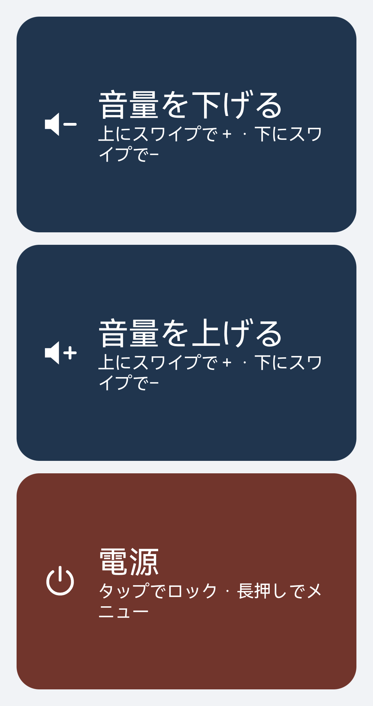

# Android 向け音量・電源ボタン

[简体中文](../../README.md) · [繁體中文](README.zh-Hant.md) · [English](README.en.md) · **日本語** · [한국어](README.ko.md) · [العربية](README.ar.md) · [ไทย](README.th.md) · [Tiếng Việt](README.vi.md) · [Русский](README.ru.md) · [Español](README.es.md) · [Français](README.fr.md) · [Português (Brasil)](README.pt.md)

物理ボタンが反応しなくなった古い Android スマートフォンでも、画面上の音量ボタンと電源ボタンで操作できます。

「仮想キー」は、画面上に大きなボタンを 3 つ表示します。音量調整、画面のロック、システムの電源メニューの表示ができます。Android 9 以降に対応し、Huawei Mate 20 X（Android 10 / EMUI 14）で動作を確認しています。

[APK v1.3 をダウンロード](https://github.com/sodino/Android-Volume-Power-keys/raw/refs/heads/develop/apk/android-volume-power-keys-v1.3.apk)

## インストールと使い方

1. デバッグ用の鍵で署名された APK をダウンロードし、端末で開いて、画面の指示に従ってインストールします。
2. 「仮想キー」を開きます。**音量を上げる** または **音量を下げる** をタップすると、音量が 1 段階変わります。どちらの音量ボタンでも、上にスワイプすると音量が上がり、下にスワイプすると下がります。スワイプ中は段階的に変わります。
3. 初めて **電源** を使うときは、ボタンをタップして「設定を開く」を選びます。Android のユーザー補助設定で「仮想キー」を有効にしてから、アプリに戻ります。検証した Huawei 端末では「ユーザー補助 → インストール済みのサービス → 仮想キー」の順に開きます。
4. **電源** をタップすると画面がロックされます。長押しするとシステムの電源メニューが開き、電源オフや再起動を選べます。

端末の電源が完全に切れると、アプリから電源を入れることはできません。物理ボタンが故障している場合は、端末を再起動したいときに電源メニューで「再起動」を選んでください。

## スクリーンショット



## アプリの表示言語

上記の 12 言語に対応しています。通常はシステム言語で表示され、対応する言語がない場合は英語になります。Android 13 以降では、システム設定でアプリごとに言語を選べます。

## ソースコードからビルド

JDK 17 と Android SDK Platform 35 を使用します。Android Studio でプロジェクトを開くか、`ANDROID_HOME` に Android SDK のディレクトリを設定してから、Gradle Wrapper でビルドします。

```sh
./gradlew :app:assembleDebug
```

生成された APK は `app/build/outputs/apk/debug/app-debug.apk` にあります。
