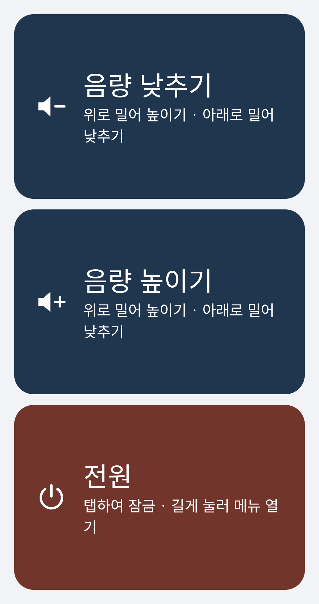

# Android용 음량 및 전원 버튼

[简体中文](../../README.md) · [繁體中文](README.zh-Hant.md) · [English](README.en.md) · [日本語](README.ja.md) · **한국어** · [العربية](README.ar.md) · [ไทย](README.th.md) · [Tiếng Việt](README.vi.md) · [Русский](README.ru.md) · [Español](README.es.md) · [Français](README.fr.md) · [Português (Brasil)](README.pt.md)

‘가상 버튼’은 화면에 큰 버튼 3개를 표시하여 음량 조절, 화면 잠금, 시스템 전원 메뉴 열기를 지원합니다. Android 9 이상에서 사용할 수 있으며, Huawei Mate 20 X(Android 10 / EMUI 14)에서 동작을 확인했습니다.

[APK v1.3 다운로드](https://github.com/sodino/Android-Volume-Power-keys/raw/refs/heads/develop/apk/android-volume-power-keys-v1.3.apk)

## 설치 및 사용

1. 디버그 키로 서명된 APK를 다운로드합니다. 휴대전화에서 파일을 열고 시스템 안내에 따라 설치합니다.
2. ‘가상 버튼’을 엽니다. **음량 높이기** 또는 **음량 낮추기**를 탭하면 한 단계씩 조절됩니다. 두 음량 버튼 모두 위로 밀면 음량이 높아지고 아래로 밀면 낮아집니다. 밀고 있는 동안 음량이 단계별로 바뀝니다.
3. **전원**을 처음 사용할 때는 버튼을 탭하고 ‘설정 열기’를 선택합니다. Android 접근성 설정에서 ‘가상 버튼’ 서비스를 켠 다음 앱으로 돌아옵니다. 테스트한 Huawei 휴대전화에서는 ‘접근성 → 설치된 서비스 → 가상 버튼’으로 이동합니다.
4. **전원**을 탭하면 화면이 잠깁니다. 길게 누르면 시스템 전원 메뉴가 열리며 전원 끄기 또는 다시 시작을 선택할 수 있습니다.

휴대전화의 전원이 완전히 꺼지면 앱으로 전원을 켤 수 없습니다. 물리 전원 버튼이 고장 난 상태에서 재부팅하려면 시스템 전원 메뉴에서 ‘다시 시작’을 선택하세요.

## 실제 화면



## 앱 언어

위에 나열된 12개 언어를 지원합니다. 기본적으로 시스템 언어를 따르며, 해당 언어를 지원하지 않으면 영어로 표시합니다. Android 13 이상에서는 시스템 설정에서 이 앱에 사용할 언어를 따로 선택할 수 있습니다.

## 소스에서 빌드

JDK 17과 Android SDK Platform 35를 사용합니다. Android Studio에서 프로젝트를 열거나 `ANDROID_HOME`을 Android SDK 디렉터리로 설정한 뒤 Gradle Wrapper로 빌드합니다.

```sh
./gradlew :app:assembleDebug
```

생성된 APK는 `app/build/outputs/apk/debug/app-debug.apk`에 있습니다.
