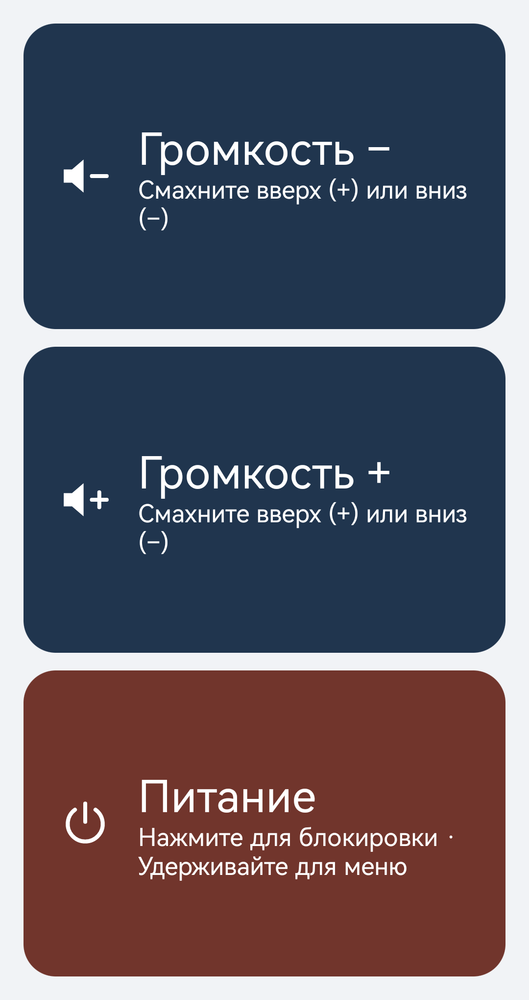

# Кнопки громкости и питания для Android

[简体中文](../../README.md) · [繁體中文](README.zh-Hant.md) · [English](README.en.md) · [日本語](README.ja.md) · [한국어](README.ko.md) · [العربية](README.ar.md) · [ไทย](README.th.md) · [Tiếng Việt](README.vi.md) · **Русский** · [Español](README.es.md) · [Français](README.fr.md) · [Português (Brasil)](README.pt.md)

Приложение добавляет экранные кнопки громкости и питания для старых телефонов Android, у которых перестали работать физические кнопки.

Приложение «Виртуальные кнопки» добавляет на экран три крупные кнопки. С их помощью можно менять громкость, блокировать экран и открывать системное меню питания. Приложение работает на Android 9 и новее. Оно проверено на Huawei Mate 20 X с Android 10 и EMUI 14.

[Скачать APK v1.3](https://github.com/sodino/Android-Volume-Power-keys/raw/refs/heads/develop/apk/android-volume-power-keys-v1.3.apk)

## Установка и использование

1. Скачайте APK, подписанный отладочным ключом. Откройте его на телефоне и следуйте указаниям Android.
2. Откройте приложение «Виртуальные кнопки». Коснитесь **Громкость +** или **Громкость −**, чтобы изменить громкость на один шаг. На любой из двух кнопок можно смахнуть вверх, чтобы повысить громкость, или вниз, чтобы понизить её. Громкость меняется по мере движения пальца.
3. При первом использовании кнопки **Питание** нажмите её и выберите **Открыть настройки**. Откройте раздел специальных возможностей, включите «Виртуальные кнопки» и вернитесь в приложение. На протестированном смартфоне Huawei откройте **Специальные возможности → Установленные службы → Виртуальные кнопки**.
4. Коснитесь кнопки **Питание**, чтобы заблокировать экран. Нажмите и удерживайте её, чтобы открыть системное меню и выбрать выключение или перезагрузку.

После полного выключения телефона приложение не сможет его включить. Если физическая кнопка питания сломана и требуется перезагрузка, выберите **Перезагрузка** в системном меню.

## Снимок экрана



## Язык приложения

Приложение поддерживает 12 языков, перечисленных выше. По умолчанию используется язык системы. Если перевода нет, приложение отображается на английском. На Android 13 и новее язык для приложения можно отдельно выбрать в системных настройках.

## Сборка из исходного кода

Используйте JDK 17 и Android SDK Platform 35. Откройте проект в Android Studio или укажите каталог Android SDK в переменной `ANDROID_HOME`. Соберите APK с помощью Gradle Wrapper.

```sh
./gradlew :app:assembleDebug
```

Готовый APK появится в `app/build/outputs/apk/debug/app-debug.apk`.
