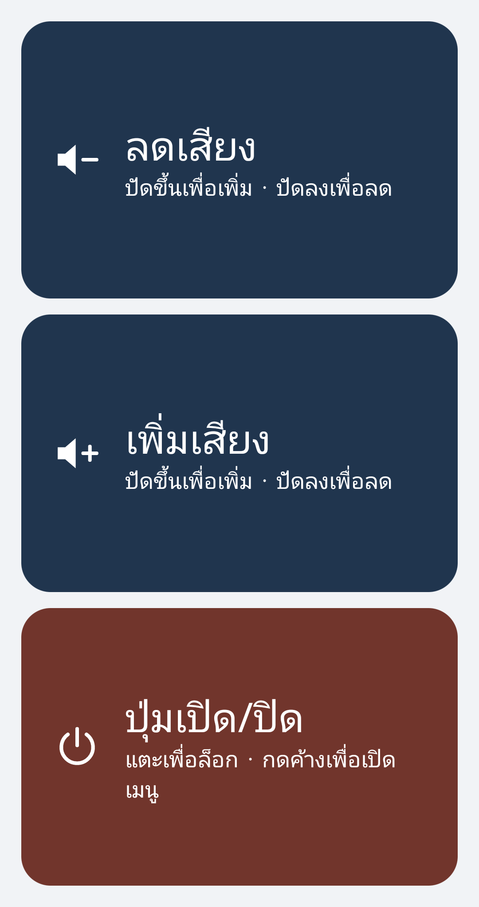

# ปุ่มปรับเสียงและปุ่มเปิด/ปิดสำหรับ Android

[简体中文](../../README.md) · [繁體中文](README.zh-Hant.md) · [English](README.en.md) · [日本語](README.ja.md) · [한국어](README.ko.md) · [العربية](README.ar.md) · **ไทย** · [Tiếng Việt](README.vi.md) · [Русский](README.ru.md) · [Español](README.es.md) · [Français](README.fr.md) · [Português (Brasil)](README.pt.md)

แอป «ปุ่มเสมือน» เพิ่มปุ่มขนาดใหญ่ 3 ปุ่มบนหน้าจอสำหรับปรับระดับเสียง ล็อกหน้าจอ และเปิดเมนูเปิด/ปิดเครื่องของระบบ ใช้ได้กับ Android 9 ขึ้นไป โดยทดสอบบน Huawei Mate 20 X ที่ใช้ Android 10 และ EMUI 14

[ดาวน์โหลด APK v1.3](https://github.com/sodino/Android-Volume-Power-keys/raw/refs/heads/develop/apk/android-volume-power-keys-v1.3.apk)

## การติดตั้งและใช้งาน

1. ดาวน์โหลด APK ที่ลงนามด้วยคีย์สำหรับการดีบัก เปิดไฟล์บนโทรศัพท์ แล้วทำตามขั้นตอนติดตั้งที่ระบบแสดง
2. เปิดแอป «ปุ่มเสมือน» แตะ **เพิ่มเสียง** หรือ **ลดเสียง** เพื่อปรับระดับเสียงครั้งละหนึ่งขั้น ปัดขึ้นบนปุ่มเสียงใดก็ได้เพื่อเพิ่มเสียง หรือปัดลงเพื่อลดเสียง ระดับเสียงจะเปลี่ยนทีละขั้นขณะปัด
3. เมื่อใช้ **ปุ่มเปิด/ปิด** ครั้งแรก ให้แตะปุ่มแล้วเลือก «เปิดการตั้งค่า» เปิดใช้ «ปุ่มเสมือน» ในการตั้งค่าการช่วยเหลือพิเศษของระบบ แล้วกลับมาที่แอป บนโทรศัพท์ Huawei ที่ใช้ทดสอบ ให้เข้า «การช่วยเหลือพิเศษ → บริการที่ติดตั้ง → ปุ่มเสมือน»
4. แตะ **ปุ่มเปิด/ปิด** เพื่อล็อกหน้าจอ หรือกดค้างเพื่อเปิดเมนูของระบบ แล้วเลือกปิดเครื่องหรือรีสตาร์ท

เมื่อโทรศัพท์ปิดเครื่องแล้ว แอปจะเปิดเครื่องให้ไม่ได้ หากปุ่มเปิด/ปิดเครื่องเสียและต้องการเริ่มระบบใหม่ ให้เลือก «รีสตาร์ท» ในเมนูของระบบ

## ภาพหน้าจอ



## ภาษาของแอป

แอปรองรับทั้ง 12 ภาษาที่แสดงด้านบน โดยใช้ภาษาของระบบเป็นค่าเริ่มต้น หากแอปไม่รองรับภาษานั้นจะแสดงเป็นภาษาอังกฤษ บน Android 13 ขึ้นไป สามารถเลือกภาษาของแอปแยกจากภาษาของระบบได้ในการตั้งค่า

## สร้างจากซอร์สโค้ด

ใช้ JDK 17 และ Android SDK Platform 35 เปิดโปรเจ็กต์ใน Android Studio หรือตั้งค่า `ANDROID_HOME` ให้ชี้ไปที่โฟลเดอร์ Android SDK จากนั้นใช้ Gradle Wrapper เพื่อสร้าง APK

```sh
./gradlew :app:assembleDebug
```

ไฟล์ APK อยู่ที่ `app/build/outputs/apk/debug/app-debug.apk`
